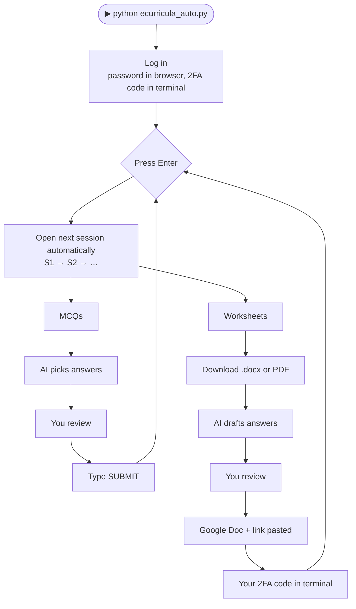

<div align="center">

# 🎓 eCurricula Helper

**Draft MCQ and worksheet answers with AI, review them, and submit, all from one terminal.**


</div>

---

## ✨ What it does

| | |
|---|---|
| 🧭 **Walks the course for you** | Press **Enter** and it opens the next session (S1 → S2 → …) by clicking the course chart. |
| ✅ **MCQs** | Reads the questions, asks the AI, shows you the picks, ticks them, and waits for you to type `SUBMIT`. |
| 📝 **Worksheets** | Downloads the `.docx` (or the PDF when there is no `.docx`), drafts the answers, and builds a **shared Google Doc** with your name on top. |
| 🔗 **Links** | Pastes the Doc link into the portal and clicks **UPDATE** for you. |
| 🔐 **2FA in the terminal** | Your 6-digit authenticator code is typed *in the terminal*, so you never switch windows. |
| ✍️ **Written-answer worksheets** | Open-ended tasks get short 4-5 line answers, with a regenerate option. |
| 🧾 **Log** | Everything is recorded in `run_out/log.csv`. |

> **You stay in control.** You review every answer, you type `SUBMIT` for the one-way MCQ submit,
> and you type your own authenticator code. The script never sees your password or your
> authenticator secret.

---

## 🧭 How it works



---

## 🚀 Quick start

**Requirements:** Python 3.10+, a Gmail account, and a free [Gemini API key](https://aistudio.google.com).

```bash
pip install -r requirements.txt
playwright install chromium
python ecurricula_auto.py
```

On the first run it asks for your **name**, **register number** (printed at the top of every
answer doc) and **Gemini key**, then saves them in `config.json` on your computer only.

<details>
<summary><b>🔧 One-time Google Drive setup (about 10 minutes)</b></summary>

Needed so the script can create the shared answer Docs.

1. Go to [console.cloud.google.com](https://console.cloud.google.com) and create a project.
2. **APIs & Services → Library** → enable **Google Drive API**.
3. **OAuth consent screen / Audience** → choose **External** and add your Gmail as a **Test user**
   (or click **Publish app**; the script only asks for the `drive.file` permission).
4. **Credentials → Create credentials → OAuth client ID → Desktop app**.
5. Download the JSON, rename it **`credentials.json`**, and put it next to the scripts.
6. On the first link, a Google sign-in window opens. An "unverified app" warning is normal for
   your own app: click **Advanced → Continue**.

Use a **personal** Gmail; university Google accounts often block link sharing.
</details>

<details>
<summary><b>🦙 Use a local model instead of Gemini</b></summary>

Install [Ollama](https://ollama.com), pull a model, then in `solve_mcqs.py` set:

```python
PROVIDER = "ollama"
OLLAMA_MODEL = "llama3.1:8b"
```

Small local models get more answers wrong, so review carefully. PDF worksheets need
`pip install pypdf` in this mode.
</details>

---

## 🎮 Controls

At the **Next: Unit X Session Y** prompt:

| Type | Does |
|---|---|
| `Enter` | Open and process the next session |
| `2 4` | Jump to Unit 2, Session 4 |
| `c` | Use the session page that is open right now |
| `m` / `w` / `b` | MCQs only / worksheets only / both |
| `q` | Quit |

At review prompts: `Enter` accepts, `2:3 5:1` overrides answers, `r` regenerates written
answers, `s` skips.

---

## 🔐 Safety & privacy

- Passwords are typed in the browser; 2FA codes are typed by **you** in the terminal.
- Your key, name and Google access stay on **your** computer in git-ignored files:
  `config.json`, `credentials.json`, `token.json`, `browser_profile/`.
- Run `git status` before every push and make sure none of those appear.
- If a key ever leaks, delete it in AI Studio and create a new one.

---

## 🗂️ Project structure

```
ecurricula-auto/
├── ecurricula_auto.py     ← run this (navigation, 2FA, worksheets, Drive links)
├── solve_mcqs.py          ← MCQ reading/answering and AI settings
├── solve_worksheets.py    ← worksheet parsing and Google Drive helpers
├── requirements.txt
└── .gitignore             ← keeps secrets out of git
```

---

## 🩺 Troubleshooting

| Problem | Fix |
|---|---|
| Google says **"Access blocked: Test user…"** | Add your Gmail under *OAuth consent screen → Test users*, or publish the app. |
| **"Could not open it automatically"** | Click the session in the browser yourself, then type `c`. |
| **No `.docx` arrives** | Normal for some sessions: it falls back to the PDF and remembers that choice. |
| **0 questions found** | The worksheet text is saved as `…docx.txt` next to the file; open an issue with its first lines. |
| **Gemini 404 / model not found** | Change `GEMINI_MODEL` in `solve_mcqs.py` to a current Flash model from AI Studio. |
| **Gemini 429** | Free-tier rate limit; the script waits and retries. |
| `FutureWarning` about Python 3.10 | Harmless; it comes from a Google library. |

---

## ⚠️ Disclaimer

This is an unofficial tool, not affiliated with SRMIST. Check your university's rules on
AI-assisted work before using it. You are responsible for everything submitted under your
name, so **read every answer before accepting it**. Portal layouts change; selectors may need
small fixes over time.
